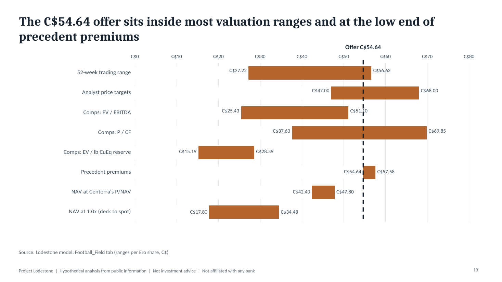
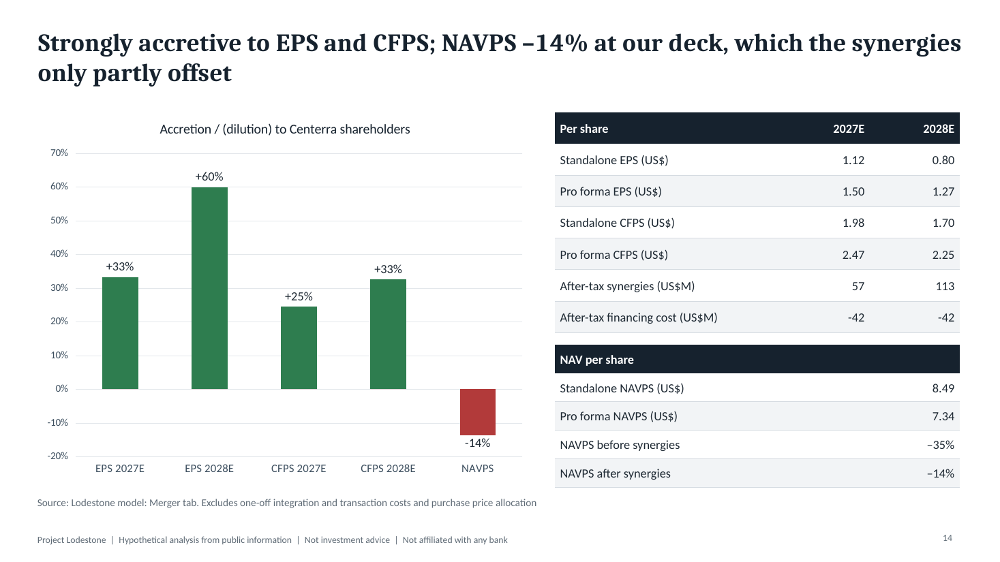
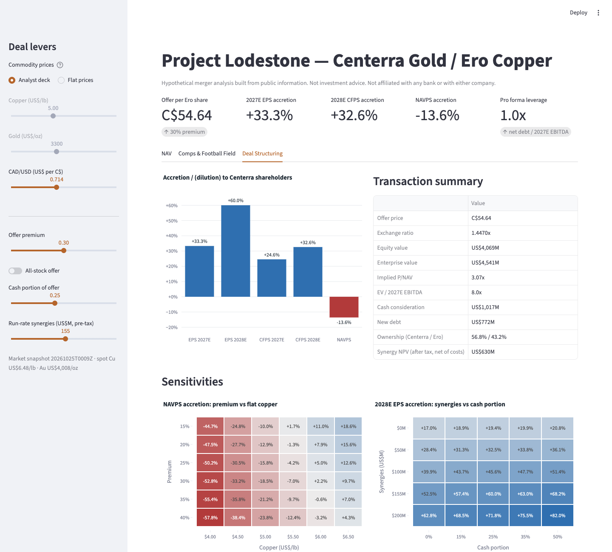

# Project Lodestone

**A buy-side pitch recommending that Centerra Gold (TSX: CG) acquire Ero Copper (TSX: ERO)**, with
the full model behind it: mine-by-mine NAVs from NI 43-101 reports, trading comps, precedent
transactions, a pro forma merger model and a live dashboard.

> Hypothetical analysis built only from public information. Not investment advice. Not affiliated
> with any bank or with either company. See [DISCLAIMER.md](DISCLAIMER.md).

**[Pitch book (PDF)](deck/pitch_book.pdf)** · **[Excel model](model/lodestone_model.xlsx)** ·
**[Live dashboard](https://project-lodestone.streamlit.app)** ·
**[Portfolio site](https://ashrahman19.github.io/project-lodestone/)**

## Investment thesis

Centerra is an essentially debt-free gold producer with a mine-life problem: Öksüt runs out by 2029,
its growth is gold, and a third of Mount Milligan's gold and a fifth of its copper are streamed to
Royal Gold. Ero has the opposite problem: two built, long-life Brazilian copper mines (Caraíba and
Tucumã) and a balance sheet still carrying US$575M of notes. Together they form an Americas-weighted
copper-gold mid-tier that is strongly accretive to earnings and cash flow.

The honest cost is NAV per share. Both stocks trade at similar multiples of our reserve-only NAV, so
the premium has to be paid for by synergies and by copper. At our below-spot price deck the deal is
NAVPS-dilutive; it breaks even as copper approaches today's spot price. The pitch says so up front.

<!-- outputs:start (generated by scripts/build_site.py) -->
| | |
|---|---|
| Offer per Ero share | **C$54.64** (30% premium; 75% stock / 25% cash) |
| Equity value / enterprise value | US$4.1Bn / US$4.5Bn (8.0x 2027E EBITDA) |
| EPS accretion, 2027E / 2028E | **+33%** / +60% |
| CFPS accretion, 2027E / 2028E | **+25%** / +33% |
| NAVPS accretion (analyst deck) | **−14%** |
| Run-rate synergies (NPV) | US$155M (US$630M) |
| Pro forma Centerra ownership | 57% |
| Pro forma net debt / 2027E EBITDA | 1.0x |

Market data as of 2026-10-25. Long-term deck: copper US$5.00/lb, gold US$3,300/oz.
<!-- outputs:end -->







## What is in the repo

| Path | What it is |
|---|---|
| [`deck/pitch_book.pdf`](deck/pitch_book.pdf) | 22-page pitch book, generated from the model by `deck/build_deck.js` |
| [`model/lodestone_model.xlsx`](model/lodestone_model.xlsx) | Excel model: Inputs, Market, six asset NAV tabs, Corporate_NAV, Comps, Precedents, Synergies, Merger, Contribution, Scenarios, Sensitivity, Football_Field, Sources |
| [`data/`](data) | Every assumption as CSV: price deck, discount rates, asset inputs, corporate items, deal terms, synergies, precedents, peers, sources, plus timestamped market snapshots |
| [`scripts/`](scripts) | Market data pipeline, workbook build, comps, scenario runner, recalculation, exports |
| [`lodestone/`](lodestone) | Python package: assumption loader, workbook builders, comps and the valuation engine |
| [`app/dashboard.py`](app/dashboard.py) | Streamlit dashboard (NAV · Comps & Football Field · Deal Structuring) |
| [`tests/`](tests) | Reconciliation of Python against Excel within 0.5%, plus behavioural tests |
| [`research/screening.md`](research/screening.md) | Target screen and why this pair |

## Methodology

- **Asset NAVs.** Each of the six assets is a reserve-constrained life-of-mine model: ore processed is
  the lesser of mill capacity and remaining reserve; grade × recovery × payability gives payable metal;
  revenue is at the analyst deck (after the Royal Gold stream at Mount Milligan); costs come from site
  cost per tonne, TC/RC, royalties and sustaining capex, calibrated to 2026 guidance. After-tax
  unlevered free cash flow is discounted mid-year at real rates of 5% for gold, 8% for copper and 6.5%
  blended for Mount Milligan.
- **Corporate NAV.** Attributable asset NAVs less capitalised G&A, plus other assets, cash and debt.
  NAVs are reserve-only, which is why both stocks trade above 1.0x.
- **Comps and precedents.** Peer multiples are live formulas on the market snapshot; precedent premiums
  come from announcement press releases.
- **Merger model.** Offer premium, exchange ratio and a consideration toggle (all-stock or
  cash-and-stock), funding from cash then new debt, pro forma ownership, accretion/dilution to EPS, CFPS
  and NAVPS, a US$155M run-rate synergy case and a contribution analysis.
- **Sensitivities.** Excel data tables do not survive automated builds, so `scripts/run_scenarios.py`
  re-runs the workbook under each copper price and records the outputs, the way an analyst would by hand.

## Sources and data quality

Every input traces to a document in [`data/sources.csv`](data/sources.csv): Centerra's year-end 2025
reserve tables and Mount Milligan PFS, Ero's reserve statements, AIF and MD&A, company guidance, and
yfinance market data. Inputs that are **estimates** rather than filed figures are flagged in
[`data/asset_assumption_notes.csv`](data/asset_assumption_notes.csv) and
[`data/peer_inputs.csv`](data/peer_inputs.csv): Mount Milligan's copper grade, Xavantina's reserve,
Goldfield's development schedule, peer reserves and the precedent premiums all carry a status column.

## Reproduce it

Requires Python 3.11+, Node 18+ and LibreOffice (for recalculation and PDF export).

```bash
python3 -m venv .venv && source .venv/bin/activate
pip install -r requirements.txt

make data     # pull a fresh market snapshot (optional; a snapshot is committed)
make model    # build the workbook, write comps, run price scenarios, recalculate
make deck     # export model outputs, build the pitch book and PDF
make site     # refresh docs/index.html and the key numbers in this README
make test     # reconcile Python against Excel and run unit tests

streamlit run app/dashboard.py
```

Change an assumption by editing a CSV under `data/` and rerunning `make model deck site test`; the
diff shows exactly what moved.

## Licence

[MIT](LICENSE). See also [SECURITY.md](SECURITY.md) and [ACCESSIBILITY.md](ACCESSIBILITY.md).
